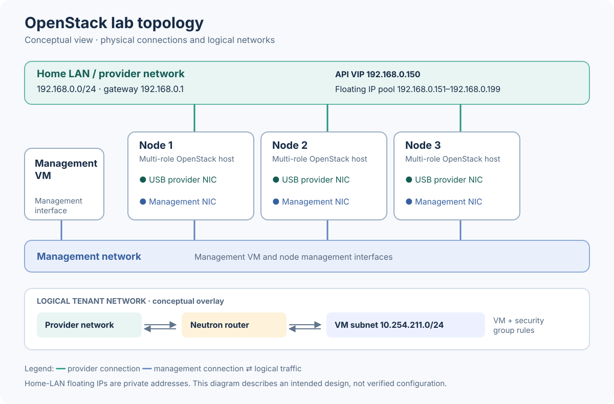

# OpenStack Lab Guide

**Draft for Joe's review — not yet an approved installation procedure.**

A hands-on guide to building and operating a small, three-node OpenStack lab with Ubuntu Server 24.04 and Kolla-Ansible. Read each checkpoint before moving on. An `ACTIVE` service or VM is a useful result, not proof that every network, storage or recovery path works.

## Start in the right place

| Your situation | Start here |
|---|---|
| New, empty lab | [Step 1: Foundations](docs/01-foundations.md) |
| Existing cloud | [Existing-cloud checkpoint](#existing-cloud-checkpoint) |
| Something failed | Stop at the failing step. Preserve the error without sharing secrets, investigate it, and recover the current cloud before considering a rebuild. |

> **Commands vs illustrations:** A block marked `bash` contains shell commands; run them only in the stated location and after the preceding checks pass. Pictures, `yaml`/`ini`/`hcl` configuration, diagrams, tables and example output are for reading or editing the specified file—not commands to type into a terminal.

## The lab at a glance

The management VM runs the deployment tools. Each of the three physical nodes has control, network and compute roles. The node's management NIC carries management/API traffic; its USB NIC connects the provider network to the home LAN. Separate SATA SSDs are intended for local storage, but local LVM is **not replicated HA storage**.

### Network plan

| Item | Planned value | What it is |
|---|---|---|
| Home LAN | `192.168.0.0/24` | The physical network. |
| Home router | `192.168.0.1` | The LAN's upstream gateway; confirmed on the node management routes. |
| Node management addresses | `192.168.0.200–202` | One address per physical node. |
| OpenStack API VIP | `192.168.0.150` | Shared address for the OpenStack APIs; not a VM floating IP. |
| Proposed floating-IP pool | `192.168.0.151–199` | Joe reports this range is outside DHCP and available. Verify current allocations before assigning any address. Router gateway ports also consume an address from the pool. |
| Private VM subnet | `10.254.211.0/24` | Private OpenStack network. Confirm it does not overlap connected VPNs or other networks before creating it. |
| Provider mapping | `physnet1` → `br-ex` → `provider0` | The current lab's verified mapping. Check it on a new build before relying on it. |
| Timezone | `Europe/Bucharest` | Lab display timezone; time synchronization remains important on all hosts. |

These are lab-specific draft values, not universal defaults. The pool being outside DHCP does not prove every address is currently unallocated. The management VM's own address, provider switch/VLAN, client source address and upstream reachability must also be confirmed for the actual installation. **Never put passwords, private keys or cloud credentials in this repository.**

## One learning path

| Step | Outcome |
|---|---|
| [1. Ubuntu and recovery access](docs/01-foundations.md#step-1--install-and-identify-the-systems) | Identify the correct OS disk, install Ubuntu and verify console recovery. |
| [2. SSH access](docs/01-foundations.md#step-2--establish-ssh-access) | Establish key-based management access to each node. |
| [3. Management tools](docs/01-foundations.md#step-3--install-kolla-ansible-on-the-manager) | Install Ansible and Kolla-Ansible on the management VM. |
| [4. Network and disk plan](docs/01-foundations.md#step-4--plan-and-configure-node-networking) | Record interfaces, addresses, VIP, floating-IP pool and storage identities. |
| [5. Kolla inventory](docs/02-deploy-openstack.md#step-5--build-and-check-the-multinode-inventory) | Target the three actual nodes in the correct groups. |
| [6. Hostnames and time](docs/02-deploy-openstack.md#step-6--verify-names-and-time) | Verify resolution, timezone and clock synchronization. |
| [7. Kolla configuration](docs/02-deploy-openstack.md#step-7--configure-globals-and-protect-passwords) | Configure interfaces and VIP; protect secrets. |
| [8. Bootstrap and prechecks](docs/02-deploy-openstack.md#step-8--verify-sudo-bootstrap-and-precheck) | Prepare hosts and stop on failing prerequisites. |
| [9. Deploy and verify](docs/02-deploy-openstack.md#step-9--deploy-and-validate) | Deploy the control plane and verify the reported APIs and agents. |
| [10. Test VM](docs/03-first-vm-and-network.md#step-10--create-the-first-test-vm) | Create a private network, image, keypair and small VM. |
| [11. Floating IP and security](docs/03-first-vm-and-network.md#step-11--connect-the-private-network-to-the-provider-lan) | Connect the VM to the provider network with restricted access; test each layer. |
| [12. Cinder storage](docs/04-storage-operations-extensions.md#step-12--plan-cinder-block-storage) | Inspect the existing SSDs and validate the LVM design before enabling storage. |
| [13. Failure and HA testing](docs/04-storage-operations-extensions.md#step-13--ha-failure-testing-and-recovery) | Plan and explicitly approve a controlled failure exercise. |
| [14. Terraform](docs/04-storage-operations-extensions.md#step-14--terraform-sandbox) | Learn infrastructure as code after the manual cloud tests. |
| [15. Monitoring](docs/04-storage-operations-extensions.md#step-15--prometheus-and-grafana) | Plan Prometheus and Grafana and verify actual metrics. |

Steps 12–15 are follow-on exercises. A storage design that hasn't been validated must be left disabled, not forced past a precheck.

## Existing-cloud checkpoint

**Do not run the fresh-install steps against an existing cloud.** The last read-only check on Joe's lab found `lab-smoke` `ACTIVE` with private address `10.254.211.204`, but no external Neutron network, router or floating IP. Its security group was `default`, and no SSH key was injected at creation. These are observations, not guarantees about the current state; recheck before making changes.

The next learning goal is Step 11: inspect what exists, then plan and separately approve the network changes. Do not delete `lab-smoke` just to create its network. A floating IP does not add a guest SSH key. The [VM and networking chapter](docs/03-first-vm-and-network.md) explains the fresh-build path and the existing-VM distinction.

For reboot/recovery of this existing deployment, use the existing `openstack-lab` repository's `docs/SHUTDOWN-AND-RECOVERY.md`, after checking that its instructions match the deployed system. Database recovery is not a routine action after every reboot.

## Safety and verification

- Before a disk, network or service change, review the exact target, impact, backup and rollback. Get explicit approval for real changes.
- Do not run `pvcreate`, `vgcreate`, reinstall Ubuntu, delete a VM or restart a service to fix an unexplained failure.
- Run commands one step at a time. Stop on errors; don't paste example output into the shell.
- Track whether a check is **passed**, **failed**, **blocked** or **not tested**. Syntax checks and simulated tests are not a live deployment.
- This is a draft for review. Three nodes and a VIP do not by themselves make every OpenStack component or its local storage highly available.
