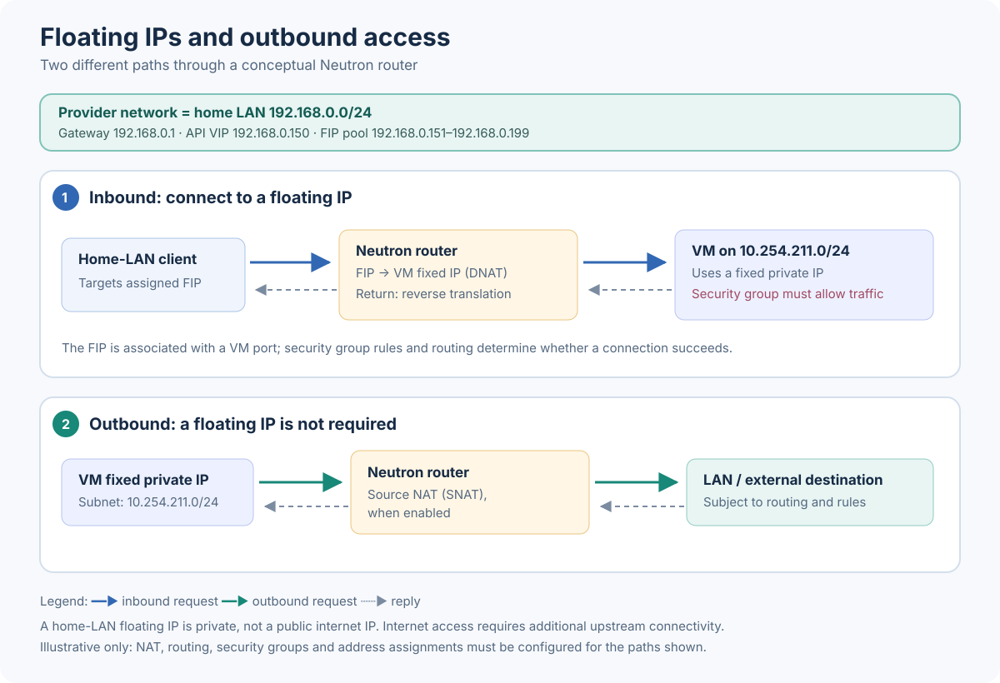

# Steps 10–11: First VM and floating IP

> **Private working draft:** The addresses below describe this lab and must be sanitized before publication. Running these steps creates cloud resources; writing this guide did not change the cloud. Run OpenStack commands on the **management VM**, as your normal user, in one terminal. At the start of that terminal, run the Step 00 path contract and set the verified `OS_CLOUD` only after reading the generated cloud names without displaying credentials. Stop at each failed gate; never rerun a create command merely because it is slow. Record IDs and which objects you created in a private local record. Names are not necessarily unique: use IDs after checking them.

**Topology — illustration only; DO NOT TYPE**



The floating IP in this example is a **LAN address**, not a public Internet address. `ACTIVE` means the VM build finished; neither that nor an associated floating IP proves guest login, inbound connectivity, outbound SNAT, or DNS.

## Step 10: Create the first test VM

### 10.1 Set up the client and authenticate

**Where:** the management VM. The deployment and configuration validation in Step 9 must have succeeded. Keep cloud configuration, tokens, private keys, console credentials and unredacted logs private.

**Existing deployment:** If the OpenStack client and a working `clouds.yaml` are already configured, skip the one-time setup below and go directly to the authentication check. Do not rerun post-deploy or overwrite configuration just to open a new terminal.

**Fresh install only:** activate the same Kolla environment used in Step 9:

```bash
source "$KOLLA_VENV/bin/activate"
```

Install the release-constrained OpenStack CLI on the management VM. Stop if installation fails:

```bash
python -m pip install python-openstackclient -c https://releases.openstack.org/constraints/upper/2026.2
```

Choose the sudo mode verified in Step 8 in this same terminal. For verified passwordless sudo on every selected host:

```bash
export ANSIBLE_BECOME_ASK_PASS=false
```

For the verified interactive alternative, use `export ANSIBLE_BECOME_ASK_PASS=true` and enter the password only at the local prompt. Run post-deploy once to generate the client configuration:

```bash
kolla-ansible post-deploy -i $KOLLA_CONFIG_PATH/multinode
```

Stop if post-deploy fails or its recap reports failed or unreachable hosts. The source and destination below contain credentials. Do not display them. On this fresh-install path, inspect both directory paths and create them **only when absent**. Stop if either path is a symlink, is not a directory, has an unexpected owner or permissions, or if any command fails:

```bash
for d in "$HOME/.config" "$HOME/.config/openstack"; do
  if [ -L "$d" ]; then
    printf 'STOP: symlink requires review: %s\n' "$d"
    break
  elif [ -d "$d" ]; then
    stat -c '%n owner=%U mode=%a' "$d"
  elif [ -e "$d" ]; then
    printf 'STOP: not a directory: %s\n' "$d"
    break
  else
    mkdir -m 700 "$d" || break
    stat -c '%n owner=%U mode=%a' "$d"
  fi
done
```

Continue only after manually confirming that both directories are owned by your normal account, the OpenStack directory is private, and no stop message appeared. Check that the source is nonempty and the destination is absent, without printing the source:

```bash
sudo test -s $KOLLA_CONFIG_PATH/clouds.yaml &&
[ ! -e "$HOME/.config/openstack/clouds.yaml" ] &&
[ ! -L "$HOME/.config/openstack/clouds.yaml" ] &&
printf '%s\n' 'Source present; destination absent.'
```

Only after that check passes, create the destination with shell **no-clobber** enabled, owner set to your account and mode 600. If a file or symlink appears before creation, the redirection fails rather than overwriting it. This creates a file containing secrets. Never add it to Git:

```bash
sudo bash -c 'umask 077; set -C; cat $KOLLA_CONFIG_PATH/clouds.yaml > "$1" && chown "$2:$3" "$1" && chmod 600 "$1"' \
  _ "$HOME/.config/openstack/clouds.yaml" "$(id -un)" "$(id -gn)"
```

If it fails, stop and inspect the destination ownership and file state without displaying its contents. Do not blindly retry. Check only its metadata:

```bash
stat -c '%n owner=%U mode=%a' "$HOME/.config/openstack/clouds.yaml"
```

**Authentication check:** For this fresh build, use the environment created in Step 00 (`$KOLLA_VENV`) and the cloud entry generated by this same fresh configuration. Do not copy or reuse the historical `kolla-admin` entry from the old deployment.

```bash
source "$KOLLA_VENV/bin/activate"
```

Then select the actual verified cloud name without displaying credentials. The generated name is release/configuration dependent:

```bash
grep -E '^  [A-Za-z0-9_.-]+:' "$KOLLA_CONFIG_PATH/clouds.yaml" | sed -E 's/^  ([^:]+):.*$/\1/'
```

Set the name returned by that command, not a historical example:

```bash
export OS_CLOUD='<verified-cloud-name>'
openstack token issue -f value -c expires
```

**Expected output:** an expiration time, not a token value. Stop if authentication fails; the configured cloud name may differ in another installation. Inspect the existing deployment and possible collisions:

```bash
openstack service list
openstack endpoint list
openstack compute service list
openstack network agent list
openstack network list --long
openstack subnet list --long
openstack router list
openstack server list --all-projects
openstack image list
openstack flavor list
openstack keypair list
openstack security group list
openstack floating ip list
```

**Expected output:** the intended Keystone, Nova, Neutron, Glance and Placement services and enabled endpoints; each expected `nova-compute`, `nova-scheduler` and `nova-conductor` row is `up` and `enabled` on its intended node, as are the expected network agents. Missing or down entries are a stop condition, not a cue to repeat deployment. The endpoint list shows registration; it does not show whether every endpoint was individually tested. Check service health and capacity, and inspect every matching name and its project, ID, settings and dependencies before reuse. Stop on ambiguous names, conflicting configuration or inaccessible project resources. Do not create another resource with the same name. The commands below are the **fresh path**; where a compatible object exists, explicitly inspect it, use its unique ID and skip its create command. Do not modify shared resources without a separate impact review. Verify `10.254.211.0/24` does not overlap any LAN, VPN, routed network or existing subnet before creating it.

**Existing deployment resume — stop and inspect, do not recreate:** The separate lab already had `lab-smoke` ACTIVE at `10.254.211.204`, with no external router/FIP and no guest key. This is historical context, not a live check. Recheck the VM, its project, port, security groups, IP and router associations now. Preserve it and its disk. Do not run the fresh VM, key injection, or network creation instructions against it automatically. Its original boot did not inject a key; adding a keypair in Nova later will not install a key in that guest. Use an authorized guest console and separately approved guest access provisioning, or get explicit approval for a **new, differently named** VM. A console URL is sensitive; keep it private:

```bash
openstack server show lab-smoke -c id -c status -c addresses -c key_name
openstack port list --server lab-smoke --long
openstack console url show lab-smoke
```

Inspect the exact port with `openstack port show '<port-id>'`, replacing the quoted placeholder with the real ID. Inspect its security groups and existing rules. If this preserved VM is separately approved for the networking exercise, record its server ID and set `VM_ID` to that ID in the same terminal before continuing to Step 11; provision guest access only through a separately approved method. The remaining instructions are not permission to change this existing cloud. `ACTIVE` and the private address alone do not establish external reachability.

### 10.2 Key, image and VM prerequisites: fresh path

The guest key must exist **before** the first boot. On the management VM, check `~/.ssh/lab-smoke` and `.pub`; if either exists, stop and inspect rather than overwrite. Generate a dedicated key locally; choose a passphrase at the prompt and never paste the private key or passphrase into chat or Git.

```bash
ssh-keygen -t ed25519 -f "$HOME/.ssh/lab-smoke" -C lab-smoke
```

Only after key generation succeeds and both key files exist, restrict the private key:

```bash
chmod 600 "$HOME/.ssh/lab-smoke"
```

Only if `lab-smoke-key` was absent from the previous check, import the public key:

```bash
openstack keypair create --public-key "$HOME/.ssh/lab-smoke.pub" lab-smoke-key
```

If it already exists, compare its public-key fingerprint with the local public key. Reuse it only if they match. Do not regenerate a lost private key and assume it matches.

Download CirrOS from its [official 0.6.3 release directory](https://download.cirros-cloud.net/0.6.3/); this x86-64 image is a disposable test image, **not production**. CirrOS has a publicly known default login and passwordless sudo: limit network exposure and remove the test VM when no longer needed. Its [publisher](https://github.com/cirros-dev/cirros) documents the guest user `cirros`.

```bash
mkdir -p "$HOME/images"
cd "$HOME/images"
[ ! -e cirros-0.6.3-x86_64-disk.img ] && curl -fL -o cirros-0.6.3-x86_64-disk.img https://download.cirros-cloud.net/0.6.3/cirros-0.6.3-x86_64-disk.img
```

If the file already exists, the test returns nonzero and leaves it untouched; verify that file before use. A failed download may leave a partial file: remove only that known incomplete local download before retrying. Fetch the checksum without overwriting an existing file:

```bash
[ ! -e cirros-0.6.3-SHA256SUMS ] && curl -fL -o cirros-0.6.3-SHA256SUMS https://download.cirros-cloud.net/0.6.3/SHA256SUMS
```

```bash
grep '  cirros-0.6.3-x86_64-disk.img$' cirros-0.6.3-SHA256SUMS | sha256sum -c -
```

**Expected output:** the image filename followed by `OK`. Stop if download or checksum verification fails. This checks consistency with the publisher's checksum over HTTPS, not an independent signature.

### 10.3 Create private networking, flavor, image and restricted security group

Only after the inspection and collision gates pass, execute each command separately; stop on failure and record each returned ID. A flavor defines the VM hardware size; an image is the boot disk template.

```bash
openstack network create lab-private
openstack subnet create lab-private-subnet --network lab-private --subnet-range 10.254.211.0/24 --dhcp
openstack flavor create lab.tiny --vcpus 1 --ram 512 --disk 1
openstack image create lab-test-image --file "$HOME/images/cirros-0.6.3-x86_64-disk.img" --disk-format qcow2 --container-format bare --private
```

```bash
openstack subnet show lab-private-subnet
openstack flavor show lab.tiny
openstack image show lab-test-image -c status
```

**Expected output:** the intended subnet and flavor, and image status `active`. Stop otherwise. For DNS tests later, inspect the private subnet's DNS servers (`openstack subnet show lab-private-subnet`). Only if needed, and only on this newly created dedicated subnet, set a verified reachable DNS resolver with `openstack subnet set --dns-nameserver <verified-resolver-ip> lab-private-subnet`; do not change DNS on a shared subnet without review.

Select the actual source address of a trusted test client on the provider LAN, accounting for any NAT. Replace the example input with its verified `/32`; never use `0.0.0.0/0` for convenience. Create a dedicated group only if absent. Default egress rules can permit outbound traffic; inspect them and all other groups because rules are additive.

```bash
TRUSTED_CIDR='<verified-client-ip>/32'
openstack security group create lab-vm-access
openstack security group rule create --ingress --ethertype IPv4 --protocol tcp --dst-port 22 --remote-ip "$TRUSTED_CIDR" lab-vm-access
openstack security group rule create --ingress --ethertype IPv4 --protocol icmp --remote-ip "$TRUSTED_CIDR" lab-vm-access
openstack security group rule list lab-vm-access
```

**Gate:** confirm only the intended ingress rules and appropriate egress are present. Before reusing an existing group, review its rules, other attached ports and ownership. Do not edit a shared group blindly.

### 10.4 Boot once and check

Choose a name that does not already exist. On a genuinely fresh installation use `lab-smoke`; if the name belongs to the existing protected VM, stop and choose a **different** name only after separate approval for a new VM. Set the chosen name in this terminal:

```bash
VM_NAME='lab-smoke'
```

Recheck `openstack server list --all-projects` for the chosen name before boot. Use the verified IDs rather than names for the flavor, image, network or security group if any names are ambiguous; never proceed with an ambiguous target. The fresh create explicitly supplies only the dedicated security group and keypair:

```bash
openstack server create "$VM_NAME" --flavor lab.tiny --image lab-test-image --network lab-private --security-group lab-vm-access --key-name lab-smoke-key --wait
```

After creation succeeds, record its returned unique server ID and set it below. Replace the quoted placeholder with that ID, without angle brackets:

```bash
VM_ID='<new-server-id>'
openstack server show "$VM_ID" -c id -c status -c addresses -c key_name
openstack port list --server "$VM_ID" --long
```

**Expected output:** `ACTIVE`, a private fixed IP, the intended key name, and a VM port on `lab-private`. Record the server ID, port ID and fixed IPv4. Inspect that port and its actual groups. If still building, inspect the same VM later; if `ERROR`, stop and diagnose safely without creating another. The VM is not yet externally reachable. Continue only after the VM, image and port gates pass.

## Step 11: Connect the private network to the provider LAN

### 11.1 Verify the physical and IP plan

This path creates a flat external provider network, dedicated router and floating IP; it does **not** reconfigure switches, node interfaces or DHCP. Verify the existing Kolla/Neutron mapping `physnet1:br-ex`, the `provider0` uplink, switch/VLAN and upstream path on the actual hosts before proceeding. A link-up indication alone does not prove that the upstream network works. The external LAN is `192.168.0.0/24`, gateway `192.168.0.1`, and Neutron pool `192.168.0.151–192.168.0.199`. Joe has confirmed that pool is excluded from DHCP; the VIP `.150` is excluded and nodes `.200–.202` are outside the pool. Confirm the pool is also clear of **all** static assignments, current allocations and other Neutron networks with the LAN administrator and the relevant DHCP/IPAM records before assignment; an unanswered ping does not establish availability. The router gateway and floating IP each consume a pool address.

Re-run the inspection in 10.1 and also:

```bash
openstack port list --server "$VM_ID" --long
openstack floating ip list
```

Select the intended port from the output; inspect it, record its original security-group IDs and existing floating IP association, and inspect any router or subnet already attached. Stop for conflicting or ambiguous resources. If an external network, subnet or router already exists, inspect type, physical mapping, CIDR, pool, gateway, SNAT, ownership and all dependent ports. Reuse a network by its ID only if it is fully compatible, and skip its create command. A reused/shared router must not have its gateway or interfaces changed without separate impact approval; if the private subnet is already attached, inspect the existing route rather than creating another router. Never allocate or associate a second FIP if one already exists on the target port without explicit review.

**Input:** Replace the placeholders with the recorded unique VM port ID, fixed IPv4 and private subnet ID. Do not type the angle brackets:

```bash
VM_PORT='<verified-vm-port-id>'
FIXED_IP='<verified-vm-fixed-ip>'
PRIVATE_SUBNET_ID='<verified-private-subnet-id>'
openstack port show "$VM_PORT"
```

The following **new dedicated network/router path** works for a fresh VM or a separately approved existing VM. Use it only when inspection confirms all three names `lab-external`, `lab-external-subnet` and `lab-router` are absent, the private subnet is not already attached to a router, and the address pool is available. Stop on a failure; record each returned ID. Never recreate the VM or its private network for this step.

Create the external network:

```bash
openstack network create --external --provider-network-type flat --provider-physical-network physnet1 lab-external
```

Record its returned ID, replacing the placeholder, then create the subnet:

```bash
EXT_NET_ID='<new-external-network-id>'
openstack subnet create --network "$EXT_NET_ID" --subnet-range 192.168.0.0/24 --gateway 192.168.0.1 --allocation-pool start=192.168.0.151,end=192.168.0.199 --no-dhcp lab-external-subnet
```

Record the returned subnet ID, then create the router:

```bash
EXT_SUBNET_ID='<new-external-subnet-id>'
openstack router create lab-router
```

Record the returned router ID. Only for this newly created dedicated router, set its gateway and attach the existing private subnet. Run the commands one at a time and stop on error:

```bash
ROUTER_ID='<new-router-id>'
openstack router set --external-gateway "$EXT_NET_ID" --enable-snat "$ROUTER_ID"
openstack router add subnet "$ROUTER_ID" "$PRIVATE_SUBNET_ID"
```

For the **existing-resource path**, do not run those creation or router-mutation commands. Inspect the existing external network, subnet and router by ID. Continue only if they already have the correct physical mapping, pool, gateway, SNAT, and private-subnet attachment; record their IDs in `EXT_NET_ID`, `EXT_SUBNET_ID` and `ROUTER_ID`. If a shared router needs a change or compatibility is uncertain, stop for a separate impact review. Do not silently edit a shared router.

For either path, inspect the selected IDs:

```bash
openstack network show "$EXT_NET_ID"
openstack subnet show "$EXT_SUBNET_ID"
openstack router show "$ROUTER_ID"
openstack port list --router "$ROUTER_ID"
```

**Expected output:** external flat `physnet1` network, matching no-DHCP subnet and allocation pool, router with SNAT enabled, external gateway port on the intended subnet, and an interface on the recorded private subnet. Stop if not. In a multi-subnet external network, explicitly verify gateway subnet selection rather than assuming it.

### 11.2 Associate a floating IP with the exact VM port

**Fresh VM:** The group was created in Step 10. Inspect its rules and the port; record the group's unique ID.

**Existing VM:** The historical `lab-smoke` used only its default group, so inspect the current groups and create a separate group only if no suitable reviewed group exists. For a new dedicated group, first select the verified trusted LAN client's actual `/32` source, accounting for NAT. Replace the placeholder, then create the group and record its returned ID:

```bash
TRUSTED_CIDR='<verified-client-ip>/32'
openstack security group create lab-vm-access
```

Only after creation succeeds, set `ACCESS_GROUP_ID` to the returned ID. Permit ping from that source:

```bash
ACCESS_GROUP_ID='<new-security-group-id>'
openstack security group rule create --ingress --ethertype IPv4 --protocol icmp --remote-ip "$TRUSTED_CIDR" "$ACCESS_GROUP_ID"
```

Add SSH from the same trusted source **only after** guest authentication is securely configured and this rule is approved:

```bash
openstack security group rule create --ingress --ethertype IPv4 --protocol tcp --dst-port 22 --remote-ip "$TRUSTED_CIDR" "$ACCESS_GROUP_ID"
```

For a reviewed existing group, do not recreate or modify it. In either path, set `ACCESS_GROUP_ID` to the verified ID of the chosen group (replace the placeholder) and inspect the group and port:

```bash
ACCESS_GROUP_ID='<verified-security-group-id>'
openstack security group rule list "$ACCESS_GROUP_ID"
openstack port show "$VM_PORT"
```

If the group is **not already attached** to the selected port and this change is approved, add it and record that this exercise added the association:

```bash
openstack port set --security-group "$ACCESS_GROUP_ID" "$VM_PORT"
openstack port show "$VM_PORT"
```

This adds a group without removing existing groups. Compare the port's complete group list with the original. Broad rules in any other group can still allow access. Check port security and guest firewall too. Do not alter a shared security group to make a test pass.

Allocate once from the verified pool, record the returned ID/address, and do not repeat if association fails:

```bash
openstack floating ip create --subnet "$EXT_SUBNET_ID" "$EXT_NET_ID"
```

**Input:** replace with the new floating-IP ID from the output; then associate the recorded port and fixed IP:

```bash
FIP_ID='<new-floating-ip-id>'
openstack floating ip set --port "$VM_PORT" --fixed-ip-address "$FIXED_IP" "$FIP_ID"
openstack floating ip show "$FIP_ID"
openstack port show "$VM_PORT"
openstack server show "$VM_ID" -c status -c addresses
```

**Expected output:** the FIP shows the recorded VM port, fixed IP and router; the VM remains `ACTIVE`. Record the actual floating address for the tests below. An API association does not test reachability.

### 11.3 Test inbound, outbound and DNS separately

From the trusted LAN client that already holds the matching private key, replace the address with the allocated FIP. Keep private keys on the machine where they were created; if that client lacks an authorized key, provision a separate public key through an approved method rather than moving a private key.

```bash
FLOATING_IP='<floating-ip>'
ping -c 3 "$FLOATING_IP"
ssh -i "$HOME/.ssh/lab-smoke" "cirros@$FLOATING_IP"
```

**Expected:** ping replies if ICMP is allowed, then SSH login as `cirros` after verifying the host key by a trusted console. Failure can be upstream filtering, security groups, routing, guest firewall/service, or key injection; a successful ping is not SSH proof. This tests LAN reachability, not public access.

From the guest's authorized console or SSH session, perform separate tests. Choose a known reachable external IP and a domain appropriate to your network:

```bash
EXTERNAL_IP='<known-reachable-external-ip>'
TEST_DOMAIN='<known-domain>'
ping -c 3 10.254.211.1
ping -c 3 "$EXTERNAL_IP"
nslookup "$TEST_DOMAIN"
```

The first tests the private gateway (confirm its actual address from subnet/router if not `.1`); the second tests outbound IP connectivity via SNAT and upstream routing, without relying on DNS; the third tests DNS resolution. ICMP may be blocked even with working routes. A failed lookup can be resolver, DNS egress or upstream policy; a successful lookup alone does not prove outbound application access. Note each PASS, FAIL or NOT TESTED independently. Never claim live connectivity from a simulated or API-only check.

### 11.4 Narrow rollback: only this exercise's changes

Rollback is optional, and it changes real cloud state. Before each command, inspect exact IDs, current associations and dependencies; stop on unexpected changes or concurrent use. Never touch preexisting resources, other ports, unrelated security groups, or shared routers. Keep a record of what this exercise actually created or attached.

1. If **this exercise** associated the recorded FIP and it still points to `VM_PORT`, disassociate it and inspect the result. Skip this block if it was never associated:

   ```bash
   openstack floating ip show "$FIP_ID"
   openstack floating ip unset --port "$FIP_ID"
   openstack floating ip show "$FIP_ID"
   ```

   Only if **this exercise allocated that exact FIP** and it is now unassociated, release it. Never delete a reused FIP:

   ```bash
   openstack floating ip delete "$FIP_ID"
   ```
2. Only if this exercise added the recorded security group to a preexisting port, and the association is still the same, remove that one group by ID and compare with the recorded originals:

   ```bash
   openstack port unset --security-group "$ACCESS_GROUP_ID" "$VM_PORT"
   openstack port show "$VM_PORT"
   ```

3. Only for a newly created dedicated router, after verifying no other dependencies, remove this exercise's private interface and external gateway, then delete it:

   ```bash
   openstack router remove subnet "$ROUTER_ID" "$PRIVATE_SUBNET_ID"
   openstack router unset --external-gateway "$ROUTER_ID"
   openstack router delete "$ROUTER_ID"
   ```

4. For full exercise cleanup, delete a **newly created test VM only after explicit approval**, verifying its ID and that no data must be preserved. Wait until deletion completes and its port is gone before deleting any newly created security group, private subnet/network, image or flavor. Delete the new external subnet/network only after confirming no router, floating IP, port or other dependency remains. Use exact IDs with `openstack server delete`, `security group delete`, `subnet delete`, `network delete`, `image delete` and `flavor delete` in dependency order. Delete a newly created keypair only when no longer needed; preserve the local private key until the operator has decided it is no longer needed. Never delete the already deployed `lab-smoke` as a rollback of this exercise. Verify each target is gone with its corresponding `show` or list command.

**Completion gate:** record the VM/port and FIP IDs, intended associations, and separate inbound SSH/ICMP, outbound IP and DNS results. Unperformed tests remain **NOT TESTED**; no network mutation or connectivity test has been performed merely by reading this guide.
